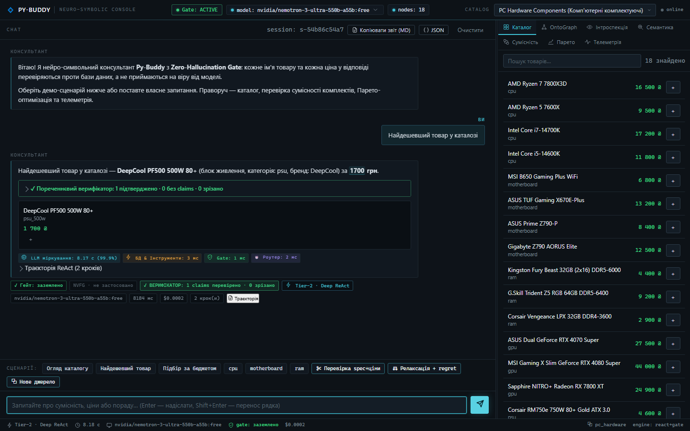
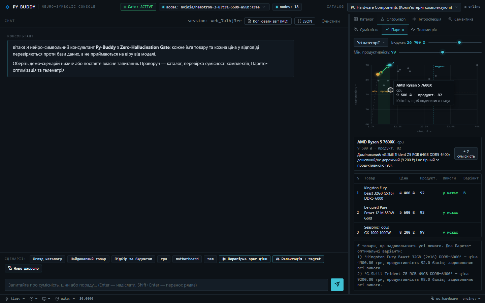

# Py-Buddy


**Neuro-symbolic domain-agnostic product advisor & grounded SQL/constraint verification engine.**  
Py-Buddy separates natural-language orchestration from deterministic database grounding: any arbitrary SQLite, CSV, JSON, Markdown, or PDF catalogue is profiled at runtime with zero domain hardcoding, indexed into a virtual compatibility hypergraph and Formal Concept Lattice, and guarded on every reply by a post-generation **Grounding Gate** and sentence-level **ClaimVerifier**.

---

## Console & Interactive Pareto Explorer

| Grounded Console & Verifier Diff | Interactive Pareto Frontier & Domination Inspector |
|---|---|
|  |  |

---

## Core Capabilities

1. **Deterministic Relational & Symbolic Core**  
   - **Auto-Profiler & Zero-Code Ingestion** ([`src/core/profiler.py`](src/core/profiler.py), [`src/core/source_projection.py`](src/core/source_projection.py), [`src/core/source_eav_discovery.py`](src/core/source_eav_discovery.py)): automatically detects flat tables, Entity-Attribute-Value (EAV) tables, foreign keys, and pricing/currency axes on any uploaded database without manual adapters.
   - **Typed Value & Unit Algebra** ([`src/core/attribute_algebra.py`](src/core/attribute_algebra.py)): parses physical measures, ranges, duplex patterns (`5x112`, `R19`), and normalizes units (`75 mg == 0.075 g`) while keeping unknown units isolated in typed dimensions (`u:oz`).
   - **Virtual Hypergraph & Pareto Relaxation** ([`src/core/hypergraph.py`](src/core/hypergraph.py), [`src/core/relaxation_lattice.py`](src/core/relaxation_lattice.py), [`src/core/pareto_relaxer.py`](src/core/pareto_relaxer.py)): evaluates multi-item compatibility (`eq`, `sum <=`, `fit`), preserves strict hard constraints via protected relaxation axes, and explains non-dominated trade-offs when budgets or constraints over-constrain the catalogue.
   - **FCA Dynamic Taxonomy & Structural Induction** ([`src/core/taxonomy_fca.py`](src/core/taxonomy_fca.py), [`src/core/contract_inductor.py`](src/core/contract_inductor.py)): builds concept lattices and induces candidate equivalence/containment rules across multilingual catalogues with admin confirmation (`candidate <-> verified`).

2. **Grounded Neuro-Symbolic Answering Pipeline**  
   - **Read-Only SQL AST Sanitizer** ([`src/core/sanitizer.py`](src/core/sanitizer.py)): blocks DDL/DML, stacked statements, and unsafe expressions before touching SQLite.
   - **Cascaded Fast Router & ReAct Engine** ([`src/core/fast_router.py`](src/core/fast_router.py), [`src/core/react_agent.py`](src/core/react_agent.py), [`src/core/react_tools.py`](src/core/react_tools.py)): resolves frequent queries locally in milliseconds and escalates complex multi-constraint reasoning to OpenRouter-backed LLMs.
   - **Grounding Gate & ClaimVerifier** ([`src/core/grounding_gate.py`](src/core/grounding_gate.py), [`src/core/claim_verifier.py`](src/core/claim_verifier.py)): verifies entity mentions, quoted prices, and token-verifiable numeric/compatibility claims against retrieved SQL evidence with bounded feedback retry and fail-closed refusal.
   - **Omnichannel Gateways** ([`src/gateways/`](src/gateways/), [`src/runners/`](src/runners/)): FastAPI Web Console, Telegram, and Discord adapters sharing session persistence and strict grounding metadata.

---

## Repository Layout

| Path | Description |
|---|---|
| `src/core/` | Engine: FastAPI server, ReAct loop, `grounding_gate`, `claim_verifier`, `source_projection`, `sanitizer`, `hypergraph`, `attribute_algebra`, `relaxation_lattice`, `pareto_relaxer`, `taxonomy_fca`, semantic retrieval |
| `src/gateways/`, `src/runners/` | Telegram & Discord adapters and CLI runners |
| `src/experiments/` | Reproducible offline/live benchmarks (`benchmark.py`, `benchmark_aic2026.py`, `cip_benchmark.py`, `scale_envelope.py`, `fiduciary_experiment.py`, `real_data_validation.py`) |
| `web/` | Browser console, Hypergraph/Pareto inspector, and live domain upload UI |
| `data/` | Demo catalogue builders (`init_database.py`, `generate_marketplace_scale.py`) & real-data ingest (`ingest_real_data.py`) |
| `docs/` | Architecture docs ([`docs/architecture/00_ARCHITECTURE_INDEX.md`](docs/architecture/00_ARCHITECTURE_INDEX.md)), benchmark report ([`docs/BENCHMARKS.md`](docs/BENCHMARKS.md)), JSON artifacts (`docs/benchmarks/`) |
| `bench/` | Retrieval recall, held-out, format parity, live vector, and 500k scale probes (`bench/results/`) |
| `tests/` | Offline unit, API, security, schema, and regression test suite (`940 passed, 6 skipped` / `946` collected cleanly without keys/models across 76 modules) |

---

## Quick Start

### Local Python Setup

```bash
pip install -r requirements.txt -r requirements-dev.txt
python scripts/bootstrap_demo_dbs.py          # generates synthetic demo DBs (idempotent)
python -m pytest tests -q                     # 940 passed, 6 skipped without keys/models
python src/core/server.py                     # starts API & Web UI at http://127.0.0.1:8000
```

### Docker

```bash
docker build -t py-buddy .
docker run --rm -p 8000:8000 -e OPENROUTER_API_KEY="${OPENROUTER_API_KEY:-}" py-buddy
```

Open `http://127.0.0.1:8000/` in your browser (not `0.0.0.0:8000`). If you launched without `OPENROUTER_API_KEY`, click the **LLM: без ключа (офлайн)** chip in the top bar to paste your own OpenRouter API key per browser session (`sessionStorage`) and fetch live OpenRouter models without restarting the container.

### Configuration

Copy `.env.example` to `.env` if you want live LLM planning (`OPENROUTER_API_KEY`). All deterministic core components, Web UI API routes, demo database initialization, and the offline `pytest` suite run completely locally without external API keys.

Key runtime environment variables (legacy `AINSA_*` names also work as fallbacks):
- `PYBUDDY_ADMIN_TOKEN`: Bearer / `X-Admin-Token` secret for administrative domain uploads, registration, switching, and rule promotion (fails closed if unset unless `PYBUDDY_LOCAL_ADMIN=1` is explicitly enabled).
- `PYBUDDY_SOURCE_ROOT`: Root directory allowed for SQLite domain registration/uploads.
- `PYBUDDY_ACTIVE_DOMAIN`: Initial active catalogue domain ID on startup.
- `PYBUDDY_LIVE_LOCAL_MODEL=1`: Opt-in flag to run gated local `multilingual-e5-small` tests.

---

## Verified Benchmark Summary

Full methodology, ablation tables, real-world catalogue breakdowns, scaling metrics, and raw JSON references are documented in **[`docs/BENCHMARKS.md`](docs/BENCHMARKS.md)**.

### Live Multi-Model Comparison (`N = 73`, `marketplace_rozetka.db`)

Source: [`docs/benchmarks/multi_model_eval_20261116.json`](docs/benchmarks/multi_model_eval_20261116.json) (zero domain-dictionary production core; `$0.9529` total API spend across 4 models + `9`-turn multi-turn split; `>=1,413` single-turn API calls):

| Model | LLM-RAG Exec Acc / Price Err / NVFG | Py-Buddy PRE Exec Acc / Hall | Py-Buddy Full Exec Acc / Price Err / NVFG | Multi-Turn (RAG -> PB) |
|---|---|---|---|---|
| `deepseek/deepseek-v4.1-flash-1017` | 47.95% / 9.28% / 56.16% | 83.56% / 9.59% | **83.56% / 0.54% / 84.93%** | 88.89% -> **100.0%** |
| `openai/gpt-6-luna` | 50.68% / 0.00% / 63.01% | 73.97% / 2.74% | **83.56% / 1.14% / 83.56%** | 66.67% -> 66.67% |
| `xiaomi/mimo-v2.6-flash` | 53.42% / 14.29% / 63.01% | 65.75% / 10.96% | **79.45% / 1.18% / 80.82%** | 88.89% -> 66.67% |
| `anthropic/claude-haiku-5.5` | 49.32% / 19.54% / 61.64% | 65.75% / 16.44% | **73.97% / 4.27% / 78.08%** | 55.56% -> 55.56% |

- **Constraint Induction (`cip_benchmark`):** Precision `28.57% -> 64.71%`, Recall `18.18% -> 100.0%`, **F1 `22.22% -> 78.57%`**, invariant across anonymized bilingual headers; `7` structural rules discovered on Ukrainian `jury_zoo.db` (420 entities, 1,519 EAV rows) with zero domain seed vocabularies.
- **Public Catalogues (`real_off`, `real_prices`, `real_wdc`):** Up to **`100%` recall** via Evidence-Bound Relaxation where flat lexical FTS scores **`0%`**, plus typed unit algebra unification (`0.075 g == 75 mg`) without false merges on unknown unit tokens.
- **Scale & Speed:** `1.0 ms` median query latency up to `50,000` SKUs (`+60.6 MB` RSS, `1.08 s` build), and `0.88 s` indexed FTS5 EBR scan at **`500,000` SKUs**.
- **Fiduciary Audit (`FIC-1.1`):** **`0.0` Fiduciary Instability Deviation (`FID`)** — `0/30` items displaced under synthetic sponsorship & commission injections (`CERTIFIED`), vs `20–24` displaced items on biased controls.

---

## Documentation

| Document | Topics |
|---|---|
| [`docs/BENCHMARKS.md`](docs/BENCHMARKS.md) | Live multi-model eval, CIP induction, real-data catalogs, scale envelope, FID audit |
| [`docs/architecture/00_ARCHITECTURE_INDEX.md`](docs/architecture/00_ARCHITECTURE_INDEX.md) | Architecture map & module links |
| [`docs/architecture/01_GLOBAL_ARCHITECTURE.md`](docs/architecture/01_GLOBAL_ARCHITECTURE.md) | Dual-plane neuro-symbolic dataflow & core guarantees |
| [`docs/architecture/02_SYSTEM_KERNEL.md`](docs/architecture/02_SYSTEM_KERNEL.md) | Fast Router, ReAct loop, SQL AST Sanitizer, Grounding Gate & ClaimVerifier |
| [`docs/architecture/03_SYMBOLIC_CORE_HYPERGRAPH_LATTICE.md`](docs/architecture/03_SYMBOLIC_CORE_HYPERGRAPH_LATTICE.md) | Compatibility hypergraph, relaxation lattice, Pareto frontier, attribute algebra |
| [`docs/architecture/04_FCA_AND_DYNAMIC_TAXONOMY.md`](docs/architecture/04_FCA_AND_DYNAMIC_TAXONOMY.md) | Formal Concept Analysis (FCA) lattice navigation |
| [`docs/architecture/05_DATA_FABRIC_AND_PROFILER.md`](docs/architecture/05_DATA_FABRIC_AND_PROFILER.md) | Schema auto-profiler, EAV discovery, multi-vendor normalization |
| [`docs/architecture/06_API_OMNICHANNEL_AND_UI.md`](docs/architecture/06_API_OMNICHANNEL_AND_UI.md) | FastAPI endpoints, SQLite WAL sessions, Telegram/Discord gateways, Web UI |

---

## Engineering Guarantees & Known Scope Boundaries

- **Fail-closed schema & unit isolation:** Unrecognized units stay isolated (`5 oz -> u:oz`), absent catalog prices remain `None` rather than defaulting to `0.0`, and induced compatibility constraints remain `candidate` (`unknown` verdict until operator-verified).
- **Deterministic grounding checks:** `ClaimVerifier` validates entity names, prices, numeric quantities, and specification/contradiction claims against retrieved SQLite evidence; qualitative or subjective prose without numeric/entity anchors lies outside symbolic verification.
- **Domain compatibility rules:** Structural constraint families (`socket`, `PCD`, clearance limits) apply only when corresponding attributes exist in the ingested catalogue rather than injecting domain-specific assumptions globally.

---

## License

MIT — see [`LICENSE`](LICENSE).
