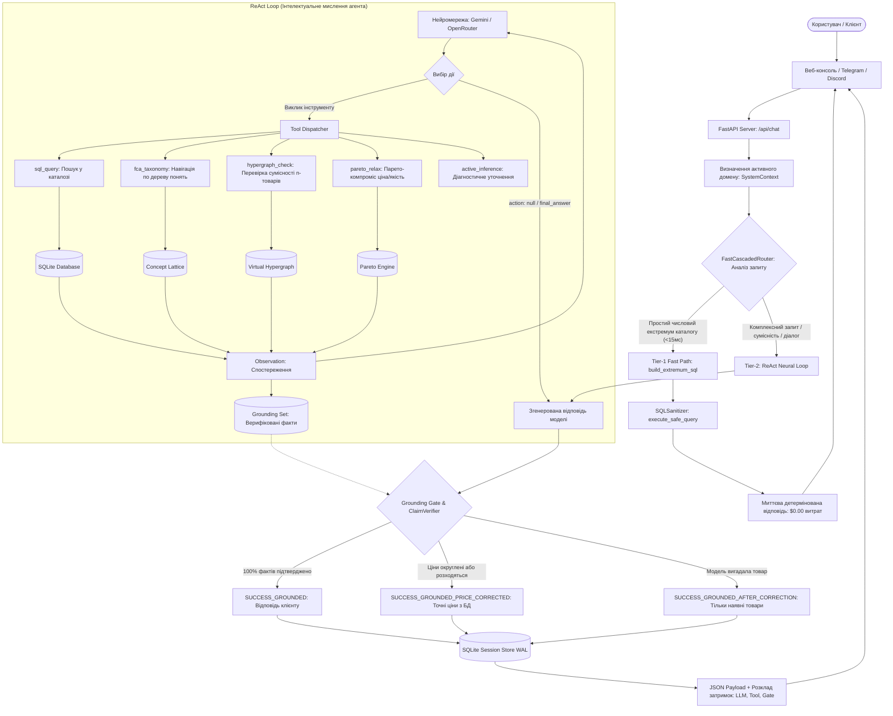

# Архітектура системи Py-Buddy
## Документ 1: Загальна архітектура та нейро-символічні контракти

> **Статус:** Нормативна документація проєкту  
> **Наукова основа:** Active Inference Neuro-Symbolic Agent з нульовою зміною коду ($ZCCS = 0$)  
> **Дата оновлення:** Жовтень 2026  

---

### 1. Головна мета та філософія платформи

**Py-Buddy** — це універсальна нейро-символічна платформа електронної комерції, призначена для автономної консультації, валідації сумісності та компромісного підбору товарів.

Головна архітектурна відмінність від звичайних LLM-чатботів:
* **Звичайний LLM-асистент:** генерує текст і ціни на основі ваг нейромережі $\rightarrow$ неминуче галюцинує цінами, неіснуючими товарами та вигаданою сумісністю.
* **Py-Buddy:** розділяє систему на **Нейронний контур (Neural Plane)** для розуміння природної мови та **Символічний контур (Symbolic Plane)** для детермінованої перевірки фактів, сумісності й цін. Жодне твердження моделі не потрапляє клієнту без верифікації арбітром **Grounding Gate** і реченнєвим верифікатором **ClaimVerifier**.

```
                           РОЗПОДІЛ КОНТУРІВ ВІДПОВІДАЛЬНОСТІ
  ┌─────────────────────────────────────────────────────────────────────────────────┐
  │                           НЕЙРОННИЙ КОНТУР (NEURAL PLANE)                       │
  │  - Розуміння природної мови користувача (будь-якою мовою, сленг, синоніми)     │
  │  - Формування наміру та плану дій (ReAct Thought & Plan)                        │
  │  - Генерація зв'язного тексту діалогу та пояснень                               │
  └──────────────────────────────────────┬──────────────────────────────────────────┘
                                         │ Виклики інструментів / План
                                         ▼
  ┌─────────────────────────────────────────────────────────────────────────────────┐
  │                         СИМВОЛІЧНИЙ КОНТУР (SYMBOLIC PLANE)                     │
  │  - Детермінований SQL-рушій із AST-валідатором (SQLSanitizer)                   │
  │  - Ієрархічна ґратка понять (Formal Concept Analysis & Taxonomy)                 │
  │  - Віртуальний гіперграф сумісності (KnowledgeHypergraph: Point, Sum, Fit)       │
  │  - Багатофакторна оптимізація компромісів (Fuzzy Pareto Relaxer)                │
  │  - Grounding Gate & ClaimVerifier (строгий арбітраж фактів і цін)               │
  └─────────────────────────────────────────────────────────────────────────────────┘
```

---

### 2. Загальна схема потоку даних (End-to-End Master Dataflow)

Нижче наведено повну схему обробки запиту клієнта від моменту надходження до веб-консолі/месенджера до фінальної верифікованої відповіді:



---

### 3. Фундаментальні архітектурні інваріанти

1. **Інваріант нульової модифікації коду при зміні схеми ($ZCCS = 0$ — Zero-Code-Change Schema Ingestion):**
   - Будь-яка валідна база даних SQLite (електроніка, одяг, автотовари, продукти, аптека) підключається «на льоту».
   - Система автоматично профілює типи полів, виявляє EAV-структури та будує ґратку понять без написання жодного нового рядка коду в роутері чи агентах.
2. **Пофактове заземлення фактів (Grounded Factuality):**
   - Жоден артикул товару і жодна ціна не можуть з'явитися у фінальній відповіді, якщо вони не були попередньо завантажені детермінованим запитом до БД і зафіксовані в `self.grounding`.
3. **Принцип відкритого кошика (Open Basket Compatibility):**
   - Для роздрібних каталогів, де товари не утворюють складних фізико-інженерних збірок (наприклад, харчові продукти чи косметика), відсутність гіперребер несумісності автоматично означає повну сумісність для спільної покупки (`is_compatible = True`).
4. **Фідуціарна нейтральність (Fiduciary Neutrality):**
   - Система оптимізує корисність для користувача (найкраща ціна, надійність продавця, термін доставки), не надаючи прихованих переваг окремим вендорам і не нав'язуючи жорстких фільтрів.

---

### 4. Структура документації архітектури

Ця серія документів повністю описує кожен модуль платформи:
* **[01_GLOBAL_ARCHITECTURE.md](../../docs/architecture/01_GLOBAL_ARCHITECTURE.md):** Загальна архітектура, філософія та генеральний Mermaid-потік.
* **[02_SYSTEM_KERNEL.md](../../docs/architecture/02_SYSTEM_KERNEL.md):** Ядро системи — Fast Router, ReAct Loop, Grounding Gate & ClaimVerifier, Model Router.
* **[03_SYMBOLIC_CORE_HYPERGRAPH_LATTICE.md](../../docs/architecture/03_SYMBOLIC_CORE_HYPERGRAPH_LATTICE.md):** Віртуальний гіперграф, контракти сумісності, ґратка послаблення обмежень, Парето-оптимізація.
* **[04_FCA_AND_DYNAMIC_TAXONOMY.md](../../docs/architecture/04_FCA_AND_DYNAMIC_TAXONOMY.md):** Пам'ять каталогу — Formal Concept Analysis (FCA), Галуа-ґратки, подолання Horizon Truncation.
* **[05_DATA_FABRIC_AND_PROFILER.md](../../docs/architecture/05_DATA_FABRIC_AND_PROFILER.md):** Адаптивна фабрика даних, автопрофайлер, нормалізація EAV, AST Sanitizer.
* **[06_API_OMNICHANNEL_AND_UI.md](../../docs/architecture/06_API_OMNICHANNEL_AND_UI.md):** Серверний API, мультиканальні шлюзи (Telegram/Discord), сесії WAL та веб-інтерфейс.
