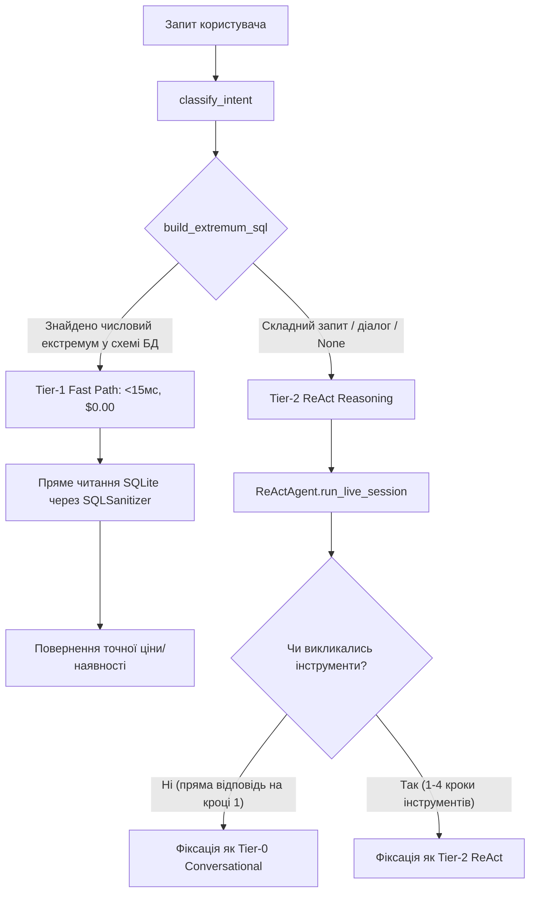

# Архітектура системи Py-Buddy
## Документ 2: Ядро системи (System Kernel & ReAct Execution)

> **Ключові файли модуля:**  
> - [`src/core/fast_router.py`](../../src/core/fast_router.py)  
> - [`src/core/react_agent.py`](../../src/core/react_agent.py)  
> - [`src/core/sanitizer.py`](../../src/core/sanitizer.py)  
> - [`src/core/grounding_gate.py`](../../src/core/grounding_gate.py)  
> - [`src/core/claim_verifier.py`](../../src/core/claim_verifier.py)  
> - [`src/core/openrouter_client.py`](../../src/core/openrouter_client.py)  
> - [`src/core/router.py`](../../src/core/router.py)  

---

### 1. Каскадний маршрутизатор виконання (`FastCascadedRouter`)

Файл: [`src/core/fast_router.py`](../../src/core/fast_router.py)

Маршрутизатор вирішує, **який контур виконання** повинен обробляти запит користувача, щоб мінімізувати час відповіді та вартість токенів без втрати точності.

#### Рівні виконання (Execution Tiers):
1. **Tier-1 Fast Path (`tier1_fast_path`):**
   - **Затримка:** $<15$ мс. **Вартість:** $\$0.00$.
   - **Призначення:** Прості однофакторні екстремуми (наприклад: *«найдешевший процесор AMD»*, *«максимальна ціна на молоко»*, *«min price tire»*).
   - **Принцип роботи:** Метод `build_extremum_sql` dynamically інспектує `PRAGMA table_info(products)` та перевіряє `DISTINCT brand`, `DISTINCT category`. Якщо виявлено замкнений мовний маркер екстремуму (`найдешевш`, `min`, `max`) і категорію з підключеної БД, запит формується напряму і виконується без звернення до LLM.
2. **Tier-0 Conversational (`tier0_conversational`):**
   - **Затримка:** Залежить від моделі (~1-2 сек). **Вартість:** 1 крок токенів (~$0.0001).
   - **Призначення:** Привітання, питання про можливості системи (*«хто ти»*, *«який асортимент»*, *«як працюєш»*).
   - **Принцип роботи:** LLM на першому ж кроці повертає `final_answer` без виклику інструментів. Роутер фіксує це постфактум за відсутністю хешів інструментів (`len(tool_hashes) == 0`). Жодного хардкоду регулярних виразів привітань!
3. **Tier-2 ReAct Reasoning (`tier2_react_reasoning`):**
   - **Призначення:** Багатофакторні консультації, пошук за неповними критеріями, перевірка сумісності комплектів, Парето-компроміси.

---

### 2. Автономний агент ReAct (`ReActAgent`)

Файл: [`src/core/react_agent.py`](../../src/core/react_agent.py)

Реалізує ітеративний цикл **Thought $\rightarrow$ Action $\rightarrow$ Observation** з повною підтримкою відновлення після помилок.

#### Особливості реалізації:
* **Захист від помилкових викликів `final_answer`:**
  Якщо модель повертає `{"action": "final_answer", "action_input": {"final_answer": "..."}}`, диспетчер агента автоматично перехоплює це як завершення сесії, не витрачаючи зайві 25–35 секунд на повторний запит до LLM з помилкою `Unknown tool: 'final_answer'`.
* **Телеметрія по кроках (Fine-Grained Latency Tracking):**
  Кожен крок ReAct-траєкторії розкладається на три метрики:
  - `llm_latency_s` — час генерації токенів нейромережею;
  - `tool_latency_s` — час локального виконання інструменту (SQL, гіперграф, Парето);
  - `gate_latency_s` — час символічної валідації арбітром Grounding Gate та ClaimVerifier.
* **Накопичення заземлення (`self.grounding`):**
  Кожен результат `sql_query`, `fuzzy_suggestions` чи `fetch_candidates` автоматично реєструється в `GroundingSet`. LLM не може передати у відповідь те, що не пройшло крізь цей пул.

---

### 3. Санітайзер запитів та арбітр (`SQLSanitizer`)

Файл: [`src/core/sanitizer.py`](../../src/core/sanitizer.py)

Забезпечує детермінізм, захист від ін'єкцій та адаптивне відновлення:
1. **Строгий Read-Only AST:**
   - Блокує будь-які мутуючі дієслова (`DROP`, `DELETE`, `UPDATE`, `INSERT`, `ALTER`, `ATTACH` тощо).
   - Забороняє ланцюжки запитів через крапку з комою (Multi-statement query chaining).
   - Автоматично інжектує або обмежує `LIMIT` (за замовчуванням 20, максимум 50).
2. **Автоматичне екранування внутрішніх апострофів (Ukrainian Apostrophe Auto-Escaping):**
   - У слов'янських мовах слова на кшталт `пам'ять`, `м'ясо`, `п'ять` містять одинарний апостроф, який у SQL передчасно закриває рядковий літерал.
   - Санітайзер автоматично перетворює внутрішні апострофи між літерами на подвійні: `'пам''ять'`, гарантуючи відсутність синтаксичних помилок SQLite без доменного хардкоду.
3. **Category-Preserving Fuzzy Fallback (`_fuzzy_fallback_search`):**
   - Якщо точний SQL повертає 0 рядків, механізм автоматично шукає схожі токени з релевантним скорингом.
   - **Критичний інваріант:** якщо у початковому запиті був фільтр `category = '...'`, фаззі-пошук шукає схожі товари **виключно всередині тієї ж категорії**, унеможливлюючи ситуацію, коли на запит відеокарти пропонуються материнські плати.

---

### 4. Grounding Gate & ClaimVerifier (Символічні верифікатори)

Розташовані у: [`src/core/react_agent.py:finalize_response`](../../src/core/react_agent.py#L293), [`src/core/grounding_gate.py`](../../src/core/grounding_gate.py), [`src/core/claim_verifier.py`](../../src/core/claim_verifier.py)

Арбітр перевіряє фінальний текст перед відправкою клієнту:

| Статус вердикту | Значення | Дія арбітра |
| :--- | :--- | :--- |
| `SUCCESS_GROUNDED` | 100% фактів, назв та цін підтверджено | Текст передається клієнту без змін |
| `SUCCESS_GROUNDED_PRICE_CORRECTED` | Модель назвала правильні товари, але округлила або змінила ціну | Арбітр замінює текст на детермінований рендер із точними цінами з БД |
| `SUCCESS_GROUNDED_AFTER_CORRECTION` | Модель запропонувала 3 товари, з яких 1 не підтверджений БД | Вигаданий товар відсікається, показуються лише реально заземлені |
| `HALLUCINATION_GATE_VIOLATION` | Жоден факт чи ціна не підтверджені даними каталогу | Блокування відповіді. Клієнту повертається безпечне повідомлення з проханням уточнити критерії |

---

### 5. Модельний роутер та юніт-економіка (`ModelRouter`)

Файл: [`src/core/router.py`](../../src/core/router.py)

Керує пулом моделей (швидкі моделі для простих перевірок, потужні моделі для складного міркування). Розраховує реальні витрати за формулою:
$$\text{Cost} = \sum_{\text{calls}} \left( N_{\text{prompt}} \cdot P_{\text{prompt}} + N_{\text{completion}} \cdot P_{\text{completion}} \right)$$
Вся телеметрія витрат агрегується в режимі реального часу і транслюється у веб-інтерфейс.
