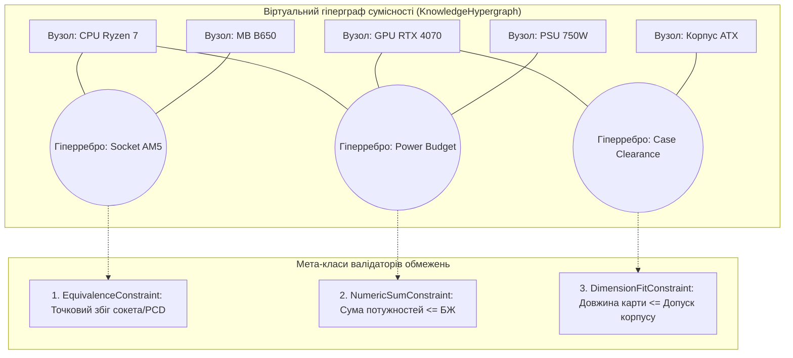

# Архітектура системи Py-Buddy
## Документ 3: Символічне математичне ядро (Hypergraph, Lattice & Pareto)

> **Ключові файли модуля:**  
> - [`src/core/hypergraph.py`](../../src/core/hypergraph.py)  
> - [`src/core/relaxation_lattice.py`](../../src/core/relaxation_lattice.py)  
> - [`src/core/pareto_relaxer.py`](../../src/core/pareto_relaxer.py)  
> - [`src/core/attribute_algebra.py`](../../src/core/attribute_algebra.py)  

---

### 1. Віртуальний гіперграф сумісності (`KnowledgeHypergraph`)

Файл: [`src/core/hypergraph.py`](../../src/core/hypergraph.py)

Традиційні графи обмежуються бінарними ребрами $(u, v)$. В електронній комерції сумісність є **n-арною** (наприклад: процесор, материнська плата, оперативна пам'ять та блок живлення утворюють спільний контекст сумісності). Тому система використовує **гіперграф**, де гіперребро охоплює довільну кількість вузлів:
$$e = \{v_1, v_2, \dots, v_k\}$$

#### Вузол товару (`ProductNode`):
* `frozen=True` з `MappingProxyType`: словник атрибутів захищений від мутацій у пам'яті під час паралельних сесій.
* `hash=False` на атрибутах: два вузли з однаковим `id` є еквівалентними, що дозволяє індексувати мільйони товарів у множинах `Set[ProductNode]`.

#### Три універсальні мета-класи обмежень:
1. **`EquivalenceConstraint` (Точкова еквівалентність):**
   - Вимагає однакового значення ключового атрибута серед усіх товарів набору, що володіють цим атрибутом.
   - *Приклади:* сокет процесора і материнки (`socket: AM5`), тип пам'яті (`memory_type: DDR5`), розболтовка автодиска і маточини (`pcd: 5x112`).
2. **`NumericSumConstraint` (Сумарні балансові обмеження):**
   - Вимагає, щоб сума споживання компонентів не перевищувала ліміт постачальника:
     $$\sum_{i} \text{TDP}(v_i) \cdot \text{headroom} \le \text{Wattage}(\text{PSU})$$
3. **`DimensionFitConstraint` (Геометричні габарити):**
   - Перевіряє фізичне розміщення компонентів (довжина відеокарти $\le$ довжина відсіку корпусу; діаметр колеса $\le$ колісна арка).

#### Принцип відкритого кошика (Open Basket Invariant):
Якщо активний каталог не містить фізико-інженерних обмежень збірки (наприклад, харчові продукти `openfoodfacts` чи побутові товари маркетплейсу), кошик вважається сумісним за замовчуванням (`is_compatible = True`, `conflicts = []`). Метод `is_compatible` повертає `True`, забезпечуючи безшовний checkout.

#### Ліниве завантаження товарів (`lazy_node_loader`):
При масштабі $10^5+$ товарів зберігати всі вузли в оперативній пам'яті нераціонально. Гіперграф завантажує атрибути товарів з SQLite за запитом (Just-In-Time) через `_ensure_loaded(item_ids)`.

---

### 2. Ґратка релаксації обмежень (`RelaxationLattice`)

Файл: [`src/core/relaxation_lattice.py`](../../src/core/relaxation_lattice.py)

Коли бюджет занадто малий або критерії користувача надто жорсткі, наївна система повертає `404 Not Found` або «Нічого не знайдено». Py-Buddy реалізує **математичну ґратку релаксації** $L(K)$.

#### Теорема про існування невакуумної відповіді (Theorem 1):
Нехай $C \ne \emptyset$ — скінченний каталог товарів, а $K$ — система числових нерівностей.
Простір релаксацій $L(K)$ є обмеженою ґраткою (bounded lattice) з операціями $\wedge$ (meet) та $\vee$ (join).
Якщо категорія товарів непорожня, то:
1. Завжди існує релаксація $\text{TOP}$, яка знімає всі обмеження;
2. Множина валідних релаксацій непорожня ($R \ne \emptyset$);
3. Мінімум функції жалю досягається:
   $$\min_{r \in R} \text{Regret}(r)$$
**Практичний висновок для диплому:** Система має математичну гарантію, що клієнт ніколи не залишиться без розумної альтернативи (**Non-Vacuous Factual Guarantee**).

---

### 3. Нечіткий Парето-релаксатор (`FuzzyParetoRelaxer`)

Файл: [`src/core/pareto_relaxer.py`](../../src/core/pareto_relaxer.py)

Якщо покупець має обмежений бюджет, релаксатор знаходить **Фронт Парето** над простором компромісів.

Рішення $x_1$ домінує рішення $x_2$ ($x_1 \succ x_2$), якщо за всіма параметрами воно не гірше, і хоча б за одним — строго краще:
$$\forall i: f_i(x_1) \ge f_i(x_2) \quad \wedge \quad \exists j: f_j(x_1) > f_j(x_2)$$

Парето-релаксатор аналізує 4 критерії:
1. $\text{Price} \downarrow$ (мінімізація вартості);
2. $\text{Performance / Quality} \uparrow$ (максимізація характеристик);
3. $\text{Delivery Days} \downarrow$ (швидкість доставки);
4. $\text{Merchant Rating} \uparrow$ (надійність продавця).

Метод `select_contrastive_tradeoffs` автоматично відбирає два найбільш контрастні варіанти:
* **Варіант A (Найкраща ціна):** мінімальний бюджет за прийнятних параметрів;
* **Варіант B (Максимальна якість):** невелике перевищення бюджету, що дає стрибок продуктивності на 30–50%.

---

### 4. Алгебра канонізації атрибутів (`attribute_algebra.py`)

Файл: [`src/core/attribute_algebra.py`](../../src/core/attribute_algebra.py)

На відкритих маркетплейсах продавці записують характеристики по-різному:
- *«AM5»*, *«Socket AM5»*, *«sAM5»*, *«Роз'єм процесора: AM5»*;
- *«120 Вт»*, *«120W»*, *«120 w»*, *«TDP: 120»*.

Алгебра канонізації зводить довільні рядки продавців до єдиного нормалізованого математичного базису:
- $\text{canonical\_form}("Socket AM5") \rightarrow "AM5"$;
- $\text{canonical\_form}("120 Вт") \rightarrow 120.0$.
Це дозволяє гіперграфу миттєво обчислювати сумісність навіть за брудних даних продавців.
