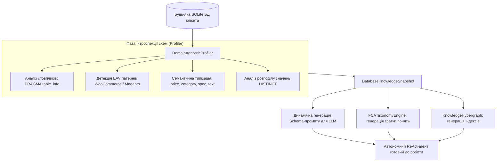

# Архітектура системи Py-Buddy
## Документ 5: Адаптивна фабрика даних та автопрофайлер (Data Fabric & $ZCCS = 0$)

> **Ключові файли модуля:**  
> - [`src/core/profiler.py`](../../src/core/profiler.py)  
> - [`src/core/domain_catalog.py`](../../src/core/domain_catalog.py)  
> - [`src/core/marketplace_normalizer.py`](../../src/core/marketplace_normalizer.py)  
> - [`src/core/entity_resolution.py`](../../src/core/entity_resolution.py)  

---

### 1. Інваріант нульової модифікації коду ($ZCCS = 0$)

В академічній концепції проєкту інваріант **Zero-Code-Change Schema Ingestion ($ZCCS = 0$)** формулюється так:
$$\forall \text{ Database } D \in \mathcal{D}_{\text{valid}}: \quad \Delta \text{LOC}(\text{AgentCode}) = 0$$
Тобто підключення абсолютно нового каталогу товарів (з невідомими раніше таблицями, колонками та типами даних) **не вимагає внесення жодних змін у вихідний код програми**.

---

### 2. Глибокий автопрофайлер (`DomainAgnosticProfiler`)

Файл: [`src/core/profiler.py`](../../src/core/profiler.py)

Профайлер сканує підключену базу без припущень про домен:
1. **Виявлення структури таблиць:**
   - Читає системні таблиці `sqlite_master`, знаходить усі користувацькі таблиці, виключаючи внутрішні сервісні таблиці.
2. **Семантична типізація колонок (`ColumnProfile.semantic_type`):**
   - `identifier`: первинні ключі, колонки `id`, `uuid`, `sku`, `code`;
   - `price`: числові поля зі згадками `price`, `cost`, `ціна`, `вартість`, `uah`, `usd`;
   - `category`: текстові дискретні поля зі співвідношенням $\frac{\text{distinct\_count}}{\text{row\_count}} < 0.1$;
   - `spec_numeric`: числові фізичні величини (`watt`, `tdp`, `weight`, `vram`, `mhz`, `length`);
   - `text_search`: довгі текстові поля опису та найменування товару (`name`, `title`, `description`).
3. **Автоматична детекція та сплющення EAV (Entity-Attribute-Value):**
   - Якщо таблиця має структуру `(entity_id, attribute_key, attribute_value)` (як у WordPress `wp_postmeta`), профайлер автоматично проектує її у віртуальний плаский вигляд для спрощення SQL-запитів LLM.
4. **Формування снапшоту (`DatabaseKnowledgeSnapshot`):**
   - Результат інтроспекції зберігається у структурованому вигляді та транслюється агенту як контекст схеми.

---

### 3. Реєстр доменних каталогів (`DomainCatalogRegistry`)

Файл: [`src/core/domain_catalog.py`](../../src/core/domain_catalog.py)

Керує мультидоменною ізоляцією. У системі за замовчуванням підтримуються та протестовані:
* **`pc_hardware`:** Комп'ютерні компоненти з повним набором фізичних контрактів сумісності (сокети AM4/AM5/LGA1700, TDP/БЖ, габарити);
* **`auto_parts`:** Автомобільні диски, маточини та шини з геометричними контрактами кріплення (PCD 5x112, 5x120, центральний отвір DIA);
* **`marketplace_rozetka` (10k товарів):** Мультидоменний відкритий каталог товарів маркетплейсу з реальними пропозиціями від різних продавців;
* **`openfoodfacts`:** База харчових продуктів із принципом Open Basket Compatibility (спільна покупка без обмежень збірки).

---

### 4. Мультивендорна нормалізація та Entity Resolution

Файли: [`src/core/marketplace_normalizer.py`](../../src/core/marketplace_normalizer.py) та [`src/core/entity_resolution.py`](../../src/core/entity_resolution.py)

На маркетплейсах один і той самий фізичний товар продають десятки незалежних вендорів:
- Продавець 1: *«Gigabyte RTX 4060 Windforce (Rev 1)»* — 11 934 грн (AutoDrive Ukraine, рейтинг 4.9);
- Продавець 2: *«Gigabyte GeForce RTX 4060 Windforce 8GB»* — 13 200 грн (Rozetka, офіційний продавець);
- Продавець 3: *«Відеокарта Gigabyte 4060 Rev 4»* — 11 985 грн (Telemart Outlet, рейтинг 4.6).

Модуль нормалізації:
1. Витягує канонічний ключ товару через хешування нормалізованої назви та характеристик;
2. Групує пропозиції різних продавців в єдиний пул;
3. Надає агенту можливість миттєво порівнювати ціни, рейтинги та умови доставки, дотримуючись принципу фідуціарної нейтральності.
