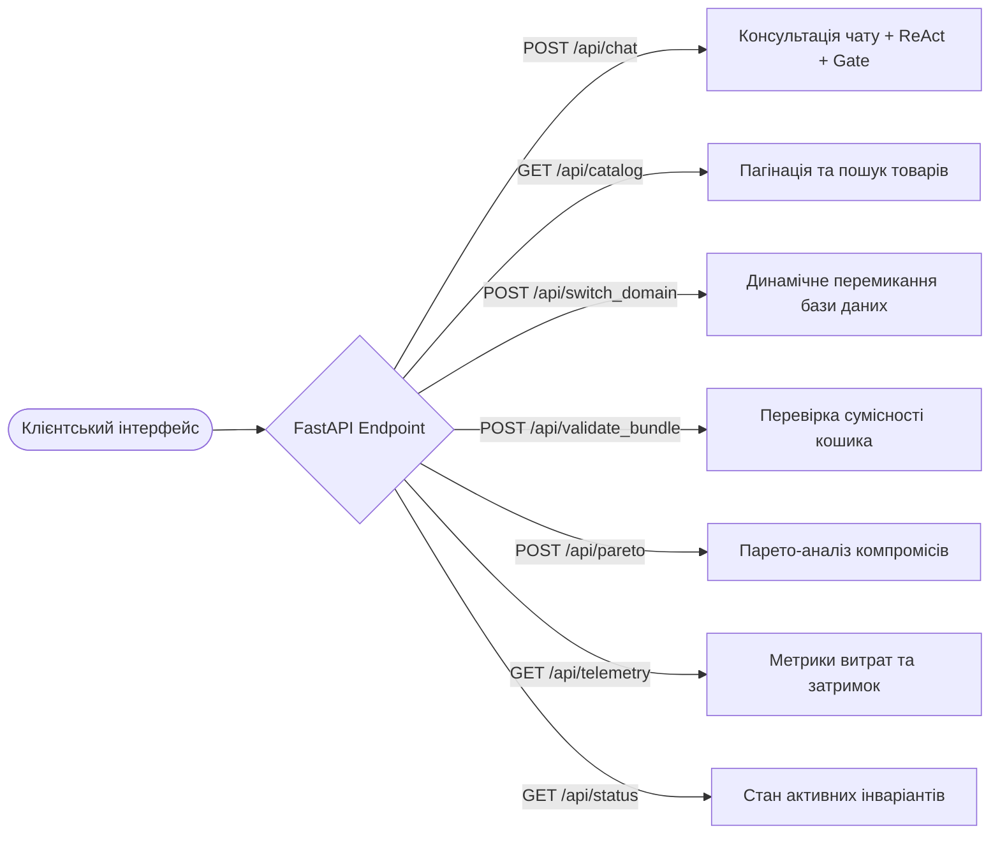

# Архітектура системи Py-Buddy
## Документ 6: Інтерфейси, мультиканальні шлюзи та веб-консоль (API & UI)

> **Ключові файли модуля:**  
> - [`src/core/server.py`](../../src/core/server.py)  
> - [`src/core/session_store.py`](../../src/core/session_store.py)  
> - [`src/gateways/telegram_adapter.py`](../../src/gateways/telegram_adapter.py)  
> - [`src/gateways/discord_adapter.py`](../../src/gateways/discord_adapter.py)  
> - [`web/index.html`](../../web/index.html) / [`web/app.js`](../../web/app.js) / [`web/style.css`](../../web/style.css)  

---

### 1. Серверний REST API (`src/core/server.py`)

Файл: [`src/core/server.py`](../../src/core/server.py)

Сервер побудований на базі **FastAPI** та **Uvicorn** з повною асинхронною підтримкою ендпоінтів:

#### Специфікація ключових ендпоінтів:

1. **`POST /api/chat`:**
   - Приймає: `{"query": str, "session_id": str, "domain": Optional[str]}`.
   - Маршрутизує запит через роутер активного домену `ctx.get_router_for_domain(domain)`.
   - Повертає повний JSON: фінальну відповідь, список верифікованих товарів, статус Grounding Gate, кроки ReAct-траєкторії та деталізований розклад затримок (`stage_timings: router_time_ms, llm_time_ms, tool_time_ms, gate_time_ms, total_time_ms`).
2. **`POST /api/switch_domain`:**
   - Дозволяє користувачеві «на льоту» змінити активну базу даних (наприклад, з PC Hardware на Rozetka Marketplace чи Open Food Facts).
   - При перемиканні система створює або дістає з кешу відповідний `DomainBundle`, ізолюючи контексти діалогів.
3. **`POST /api/validate_bundle`:**
   - Приймає набір `item_ids`. Якщо окремі товари ще не завантажені в оперативну пам'ять, ендпоінт ліниво довантажує їх із підключеної SQLite БД та запускає `hypergraph.is_compatible`.
4. **`POST /api/pareto`:**
   - Обчислює фронт Парето над товарами активного каталогу за категорією та бюджетом, повертаючи контрастні варіанти компромісів.

---

### 2. Сховище сесій (`SQLiteSessionStore`)

Файл: [`src/core/session_store.py`](../../src/core/session_store.py)

* Працює в режимі **SQLite WAL (Write-Ahead Logging)** для забезпечення високої паралельності читання/запису.
* Зберігає повну історію повідомлень користувача, проміжних думок ReAct, викликаних інструментів та відповідей арбітра.
* Забезпечує безшовне продовження діалогу при перезапуску клієнта або зміні пристрою.

---

### 3. Мультиканальні шлюзи (Omnichannel Gateways)

Файли: [`src/gateways/telegram_adapter.py`](../../src/gateways/telegram_adapter.py) та [`src/gateways/discord_adapter.py`](../../src/gateways/discord_adapter.py)

Платформа спроектована для роботи через будь-який канал зв'язку (Omnichannel E-Commerce):
* **Telegram Bot:** Адаптує вивід під HTML/MarkdownV2, автоматично форматує ціни в гривнях, додає інлайн-кнопки перевірки сумісності та швидкого замовлення.
* **Discord Bot:** Форматує відповіді у вигляді багатих Embed-карток із кольоровими індикаторами статусу Grounding Gate (зелений = верифіковано, помаранчевий = ціна скоригована за БД).

---

### 4. Клієнтська веб-консоль (`web/`)

Файли: [`web/index.html`](../../web/index.html), [`web/app.js`](../../web/app.js), [`web/style.css`](../../web/style.css)

Інтерфейс інженерного рівня для повної прозорості роботи консультанта:
1. **Інтерактивний чат із розгортанням траєкторії:**
   - Користувач бачить фінальну відповідь і бейдж статусу Grounding Gate (`SUCCESS_GROUNDED`);
   - Кожен крок можна розгорнути: переглянути внутрішню думку (Thought), сформований SQL-запит (Action), відповідь БД (Observation) та час виконання.
2. **Панель розподілу затримок (Stage Timings Bar):**
   - Наочно показує користувачеві, на що саме пішов час:
     * 🟡 `LLM`: час очікування зовнішньої нейромережі (95–99% від загального часу);
     * 🔵 `Tool`: час локального виконання SQL/гіперграфа (<10 мс);
     * 🟢 `Gate`: час символічної верифікації (<2 мс);
     * 🟣 `Router`: час каскадної класифікації (<5 мс).
3. **Панель живого каталогу (Live Catalog Explorer):**
   - Дозволяє переглядати товари активної БД із серверною пагінацією та пошуком.
4. **Конструктор та перевірка комплектів (Bundle Compatibility Checker):**
   - Дозволяє зібрати кошик і миттєво перевірити фізичну сумісність через віртуальний гіперграф.
